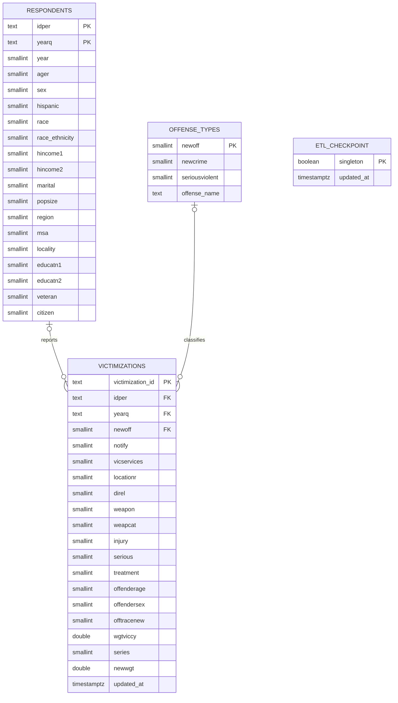

# Team 4 Term Project DAEN 328 Fall 2026 

This project extracts the Bureau of Justice Statistics National Crime
Victimization Survey (NCVS) personal victimization data, cleans it, and loads
it into PostgreSQL for a future Streamlit dashboard. The source is the public
[NCVS API](https://api.ojp.gov/bjsdataset/v1/gcuy-rt5g.json).

## Docker setup

Install Docker and Docker Compose. Copy `.env.sample` to `.env` and replace
the sample password with a local password. Then start the application:

```sh
cp .env.sample .env
# Edit .env and set POSTGRES_PASSWORD.
docker-compose up --build
```

Compose starts PostgreSQL, waits for it to be healthy, and then runs the `etl`
service once. After ETL succeeds, the Streamlit dashboard starts at
<http://localhost:8501> (or the `STREAMLIT_PORT` configured in `.env`).
The database uses a named volume so data persists when containers stop.
Database initialization settings apply when the volume is first created;
changing credentials later does not update an existing database volume.

All services receive their configuration from `.env`. `PGHOST=db` and
`PGPORT=5432` connect the ETL container to PostgreSQL inside the Compose
network; `POSTGRES_PORT` controls the port exposed on the host. If ETL fails,
the dashboard will not start. Inspect `docker compose logs etl` and rerun
`docker-compose up --build` after fixing the error. Run tests with
`docker-compose run --rm etl pytest`.

The first load creates the three tables. Later loads upsert records using their
primary keys; the entire database load is committed together. To inspect the
table counts:

```sh
docker compose exec db sh -c 'psql -h /var/run/postgresql -U "$POSTGRES_USER" -d "$POSTGRES_DB" -c "SELECT (SELECT count(*) FROM respondents) AS respondents, (SELECT count(*) FROM offense_types) AS offense_types, (SELECT count(*) FROM victimizations) AS victimizations;"'
```

## Incremental extraction

The first run pulls the full API dataset. Later runs request only records with
source `:updated_at` greater than the last successful run's maximum timestamp.
The single-row `etl_checkpoint` table stores that timestamp in PostgreSQL's
named volume. The checkpoint and all upserts commit together, so a failed run
does not advance the position. Each run logs its extraction position, cleaning
summary, and inserted and updated counts per table. Stopping with
`docker-compose down` preserves the volume for the next run.

The API must assign a later `:updated_at` when a record changes; a late-arriving
record with the same or an earlier timestamp than the checkpoint cannot be
detected by this timestamp-based pull. Full extraction completes before the
checkpoint advances, including records that share the maximum timestamp.

## Database schema

Each respondent is identified by person and survey quarter; each victimization
references that respondent and an offense classification. Demographic facts and
offense descriptions are stored once in their respective tables.
The Phase 1 fields `year` and `race_ethnicity` are retained for analysis even
though they overlap with `yearq` and the race/ethnicity codes, respectively, so
the schema is not strictly in third normal form.



The `idper` and `yearq` columns together form the foreign key from
`victimizations` to `respondents`. `load.py` defines and creates the tables and
keys, and psycopg2 upserts all three tables in a single transaction.

