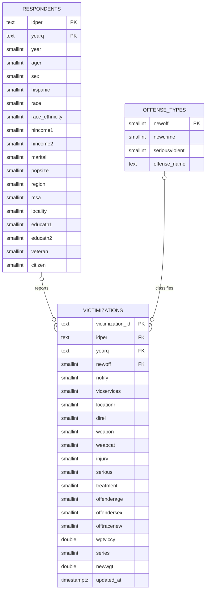

# Team 4 Term Project DAEN 328 Fall 2026 

## Docker setup

Install Docker and the Docker Compose plugin. Copy `.env.sample` to `.env` and
set a PostgreSQL password. If you have an existing `.env`, add the settings from
the sample. Then start the application:

```sh
docker compose up --build
```

Compose starts PostgreSQL, waits for it to be healthy, and then runs the `etl`
service once. After ETL succeeds, the Streamlit dashboard starts at
<http://localhost:8501> (or the `STREAMLIT_PORT` configured in `.env`).
The database uses a named volume so data persists when containers stop.
Database initialization settings apply when the volume is first created;
changing credentials later does not update an existing database volume.

All services receive their configuration from `.env`. `PGHOST=db` and
`PGPORT=5432` connect the ETL container to PostgreSQL inside the Compose
network; `POSTGRES_PORT` controls the port exposed on the host. If ETL fails,
the dashboard will not start. Inspect `docker compose logs etl` and rerun
`docker compose up --build` after fixing the error.

The first load creates the three tables. Later loads upsert records using their
primary keys; the entire database load is committed together. Each load fetches
the full dataset. To inspect the table counts:

```sh
docker compose exec db sh -c 'psql -h /var/run/postgresql -U "$POSTGRES_USER" -d "$POSTGRES_DB" -c "SELECT (SELECT count(*) FROM respondents) AS respondents, (SELECT count(*) FROM offense_types) AS offense_types, (SELECT count(*) FROM victimizations) AS victimizations;"'
```

## Database schema

Each respondent is identified by person and survey quarter; each victimization
references that respondent and an offense classification. Demographic facts and
offense descriptions are stored once in their respective tables.
The Phase 1 fields `year` and `race_ethnicity` are retained for analysis even
though they overlap with `yearq` and the race/ethnicity codes, respectively, so
the schema is not strictly in third normal form.



The `idper` and `yearq` columns together form the foreign key from
`victimizations` to `respondents`. `load.py` defines and creates the tables and
keys, and psycopg2 upserts all three tables in a single transaction.

