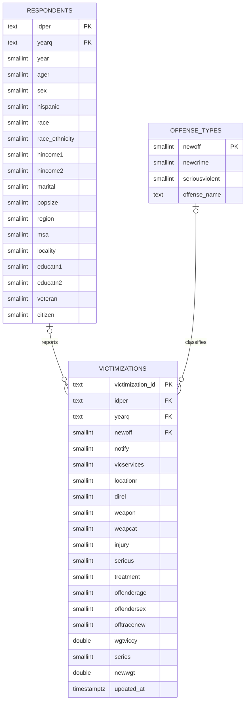

# Team 4 Term Project DAEN 328 Fall 2026 

## Docker setup

Install Docker and the Docker Compose plugin. Copy `.env.sample` to `.env` and
set a PostgreSQL password, then start the application and PostgreSQL:

```sh
docker compose up --build
```

The database is available on the port configured in `.env` and its data
persists in a Docker volume. Compose passes the `.env` settings to the app,
which loads them in code. Database initialization settings apply when the
volume is first created; changing credentials later does not update an existing
database volume.

Open <http://localhost:8501> to view the application. The first browser session
after the app starts runs the full extraction, transformation, and load. The
page shows the load status; reload it to retry if loading fails. Subsequent page
reruns and sessions reuse the successful result until the app restarts.

The first load creates the three tables. Later loads upsert records using their
primary keys; the entire database load is committed together. Each load fetches
the full dataset. To inspect the table counts:

```sh
docker compose exec db sh -c 'psql -U "$POSTGRES_USER" -d "$POSTGRES_DB" -c "SELECT (SELECT count(*) FROM respondents) AS respondents, (SELECT count(*) FROM offense_types) AS offense_types, (SELECT count(*) FROM victimizations) AS victimizations;"'
```

## Database schema

Each respondent is identified by person and survey quarter; each victimization
references that respondent and an offense classification. Demographic facts and
offense descriptions are stored once in their respective tables.
The Phase 1 fields `year` and `race_ethnicity` are retained for analysis even
though they overlap with `yearq` and the race/ethnicity codes, respectively, so
the schema is not strictly in third normal form.



The `idper` and `yearq` columns together form the foreign key from
`victimizations` to `respondents`. `load.py` defines and creates the tables and
keys, and psycopg2 upserts all three tables in a single transaction.

